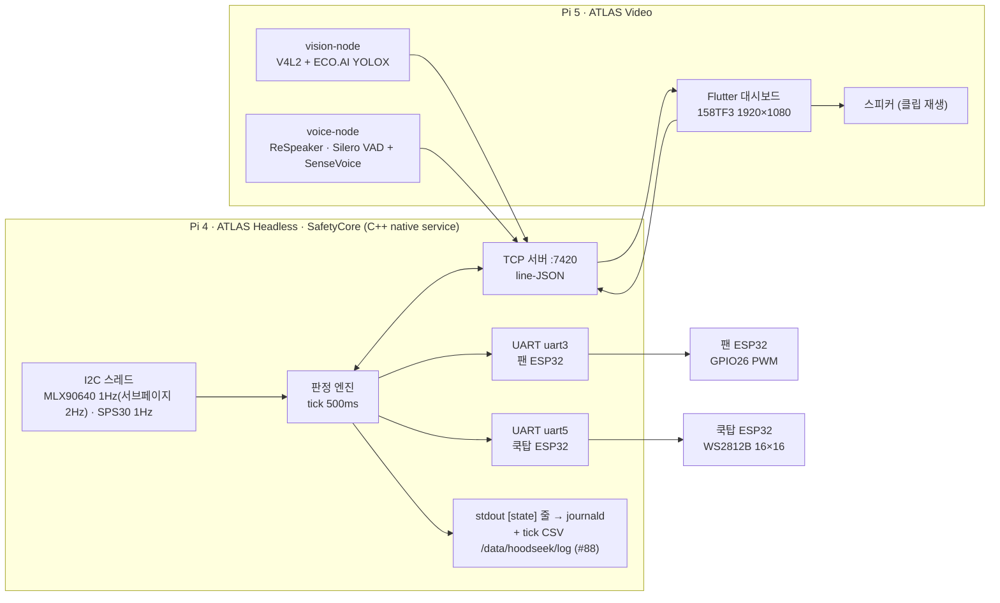

# HOOD&SEEK S3~S10 압축 설계서 v0.4

- 작성: 2026-10-19 (설계 보조 세션) / 검토·승인: PM 남현지 / v0.2 갱신: 2026-10-19 15:30 (PM 결정 "권장안대로" 반영) / v0.3 갱신: 2026-10-19 (계약 v1 PR #75·#55 반영) / v0.4 갱신: 2026-10-19 (판정 모듈 #57·#58, D-043, §11 변경 이력)
- 상태: **계약 동결 기준판 (v0.3) + 판정 모듈 규칙 (v0.4)**. §9의 결정 항목은 모두 확정됐고, §2 계약은 `contracts/` 스키마(PR #75)와 같다. 10/20(화) 18:00 PR #75 병합으로 동결하며, 동결 후 변경은 PR + 계약 `v` 증가 + 송신·수신 파서 동반.
- 파일명의 v0.1은 이슈·대장이 이 경로를 인용하고 있어 유지한다. 버전은 이 머리말이 정본.
- 저장 위치: `docs/2026-10-19-s3-s10-design-v0.1.md` (저장소 `lambdaramji/HOOD-SEEK`). 이 문서가 S3~S10의 **단일 기준**이며, 이슈·결정 대장·체크리스트의 "설계서 §x"는 이 파일을 가리킨다.
- 표기: **[결정 D-xx]** 이미 PM이 확정한 사항 · **[제안]** 이 문서에서 처음 제시, 동결 전 확인 필요 · **[문서]** 출처 있는 사실 · **[실측]** 팀 측정값 · **[추정]** 미확인, 확인 방법 병기
- 결정 번호: 이 문서의 두 자리 `D-NN`은 `docs/ai-integration-decisions.md` 대장의 세 자리 **`D-0(NN+9)`** 와 같은 결정이다 (예: D-02 = D-011, D-11 = D-020, D-29 = D-038). 대장 쪽이 정본이며 이 문서는 원래 번호를 유지한다 (PM 승인 2026-10-19).

이 문서는 S3(시스템 구성)~S10(빌드·배포)을 한 번에 다룹니다. 각 절은 "결정된 것 → 제안 → 동결 전 확인 항목" 순서입니다. 트랙 담당자는 자기 절만 읽어도 시작할 수 있게 썼습니다.

---

## 0. 설계에 직접 쓰이는 확정 사항 요약

| ID | 대장 | 내용 |
|---|---|---|
| D-02 | D-011 | Pi 4 = ATLAS 메인(Headless), Pi 5 = Flutter·YOLO·음성(Video). 카메라·마이크·스피커 → Pi 5, 팬 → ESP32 |
| D-03/D-19 | D-012 | 인덕션 = WS2812B 16×16 LED 판 시뮬레이터 (별도 쿡탑 ESP32). 경고 LED·부저 없음 |
| D-10 | D-019 | 센서·ESP32·판정 = Pi 4 **단일 C++ 네이티브 서비스 `SafetyCore`**, Stop 콜백 미등록(자동 종료 방지) |
| D-11 | D-020 | Pi 4↔Pi 5 = SafetyCore 내장 **TCP line-JSON 서버**. MQTT 폐기 |
| D-12 | D-021 | 음성 = Pi 5 whisper.cpp + PulseAudio, 터치 폴백 → #107(10/25)에서 SenseVoice(sherpa-onnx) + Silero VAD, 호출어 「하이엘지」로 바뀜(§5.3) |
| D-13 | D-022 | 비전 = Pi 5 V4L2 + ECO.AI YOLOX(TFLite). Camera1 미사용 |
| D-14 | D-023 | 경고음·안내음 = 사전 녹음 클립 |
| D-15 | D-024 | 신선도 = **수신 측 도착 시각 + seq**. 송신 타임스탬프는 참고용 |
| D-16 | D-025 | 7인치 = 사용자 대시보드. 인덕션 상태는 패널로 미러 → **2026-10-23 PM: 디스플레이 1대 = 15.8인치 smartmon 158TF3, 1920×1080** |
| D-17 | D-026 | ESP32 2대 모두 Pi 4 보조 GPIO UART(uart3 GPIO4/5 팬, uart5 GPIO12/13 쿡탑). cp210x 확인 시에만 USB |
| D-18 | D-027 | 센서 = `/dev/i2c-1` 직접 접근(MLX90640, SPS30) |
| D-20 | D-029 | 인덕션 3단. 잠금은 **켜기·올리기 차단, 내리기·끄기 항상 허용**. 음성 "켜"는 미잠금 ∧ ≤warning ∧ 재실일 때만 (D-061, 10/26 ≤mid에서 바꿈) |
| D-21 | D-030 | 쿡탑 ESP32 독립 fail-safe: 명령 끊기면 OFF |
| D-24 | D-033 | 데모 옵션 3, M1~M11 |
| D-29 | D-038 | 10/19~10/28 일정·역할 (마일스톤 G1~G8, `docs/github-projects-guide.md`) |
| E-1/E-2 | D-039 | ESP32 **2대 유지**(팬·쿡탑), 두 보드 모두 **하드웨어 워치독**(멈춤 → 리셋 → 부팅 fail-safe), LED 전원 분리·GND 공통. 1대 통합은 배송 지연 시 폴백 (2026-10-19 PM·정정인) |
| M-1 | D-040 | 시연 번호는 현재(이슈·보드) 번호 유지 + **M12 짧은 이탈 네거티브, M13 LAN 분리 fail-safe** 추가. S1 승인본(부록 A)과의 차이 8건 결정 (§7 대조표) |
| Q-S4~S10 | D-041 | §9 결정 전부 확정 (2026-10-19 "권장안대로"). Q-S5-1은 #54 B 확정, Q-S7-1은 #55 버튼 없음 |
| — | D-042 | **TCP 계약 v1** = `contracts/` 스키마 5종·예제·`validate.py` (PR #75, #52). §2를 구체화한 7건 포함, 10/20 18:00 동결 |
| — | D-043 | **판정 모듈(Policy) 경계·동작 규칙** (#57·#58): 입력 경계 6건(정인 합의), 히스테리시스 B 직행, `P_person_score`, 연속 판정은 새 샘플·메시지 단위, 잠금 해제 안전 시간 10 s, baseline 초기 60 s, 부팅 3 s 유예, PM 경고 연속 조건. 정본 `safety_core/src/policy.h` |

---

## 1. S3 시스템 구성



### 1.1 네 계층 (보고서 ②③ 설계도에 그대로 쓰는 구분)

| 계층 | 노드 | 책임 | 하지 않는 것 |
|---|---|---|---|
| L1 집행(Actuation) | 팬 ESP32, 쿡탑 ESP32 | 명령 실행 + **독립 fail-safe** | 판단 |
| L2 안전(Safety) | SafetyCore (Pi 4) | 센서 읽기, **유일한 판정**, 집행 명령, 상태 발행 | UI, AI |
| L3 인지(Perception) | vision-node, voice-node (Pi 5) | 관측·의도 **보고만** | 판단, 집행 |
| L4 사용자(HMI) | Flutter (Pi 5) | 상태 표시, 요청 전송, 클립 재생 | 판단, 잠금 해제 |

### 1.2 네트워크·주소

| 항목 | 값 | 비고 |
|---|---|---|
| Pi 4 IP | `192.168.x.A` | **[확인 필요]** 10/19 사무실에서 확정 (PM 답변 7) |
| Pi 5 IP | `192.168.x.B` | 동일 |
| SafetyCore TCP 포트 | **7420** [제안] | 미등록 포트. 바꿔도 무방 |
| 연결 방향 | Pi 5의 3개 프로세스 → Pi 4 서버로 접속 | Pi 4는 아무 데도 접속하지 않음 (안전 평면이 바깥에 의존하지 않도록) |
| 시간 | NTP 없음 [문서: LG 회신] | 모든 신선도 판정은 **수신 측 monotonic clock**. CSV 로그 벽시계는 DS3231 `hwclock -s` 1회 (Could) |

---

## 2. S4 메시지 계약 (Pi 4 ↔ Pi 5, TCP line-JSON)

스키마 정본은 `contracts/*.schema.json`이고, 코드표(`reasons`·`voice.reason`·`alert`)와 필드 규칙은 `contracts/README.md`에 있다 (D-042, PR #75). 이 절과 다르면 같은 PR에서 둘 다 고친다.

### 2.1 전송 규칙

| 규칙 | 값 |
|---|---|
| 프레이밍 | UTF-8 JSON **한 줄 = 한 메시지**, `\n` 종료. `\r` 무시 |
| 최대 길이 | 4096 byte. 초과 시 서버는 해당 연결을 **끊고** 로그 |
| 접속 직후 | 클라이언트가 `hello`를 먼저 보냄. 5초 내 없으면 서버가 끊음 |
| 서버→클라 | `state`를 **2 Hz 주기 + 변화 즉시** 브로드캐스트 (모든 클라이언트에 같은 payload, seq는 아래 규칙) |
| 재접속 | 클라이언트 1초 backoff, 무한 재시도 |
| seq | 송신자가 **연결마다** 단조 증가 32-bit. 수신자는 같은 연결에서 **역행·중복 seq 폐기**, 새 연결에서는 기준을 다시 잡음 (D-15, D-042 ①: 노드·Core 재시작 뒤 영구 폐기 방지). Core의 `state` seq는 전역 카운터라 연결 안에서 건너뛸 수 있고, 수신자는 건너뜀을 손실로 보지 않음 |
| 연결 규칙 | 연결 역할(`hello.src`), `hello` 순서, 동시 연결 최대 8개, 정수 필드 `7.0` 허용 — `contracts/README.md` 「전송 규칙」 (D-042 ⑧) |
| 신선도 | 수신 시각 기준. 타입별 유효 기간은 §2.4 |
| 검증 실패 | 메시지 폐기 + 카운터 증가. **상태를 바꾸지 않음** (CLAUDE.md 불변식) |

### 2.2 공통 envelope

```json
{"v":1,"type":"<type>","src":"<vision|voice|ui|core>","seq":123,"t_ms":4567890,"p":{...}}
```

- `v` 계약 버전(정수). 동결 후 변경 시 증가.
- `t_ms` 송신자 monotonic ms. **판정에 쓰지 않음**, 로그 상관용.
- `p` 타입별 payload.

### 2.3 타입별 payload

#### `hello` (클라 → 서버, 접속 직후 1회)
```json
{"v":1,"type":"hello","src":"vision","seq":0,"t_ms":0,
 "p":{"node":"vision-node","ver":"0.1.0"}}
```
서버 응답: `state` 1회 즉시.

#### `vision` (vision-node → 서버, 추론마다, ≈3 Hz)
```json
{"v":1,"type":"vision","src":"vision","seq":881,"t_ms":120331,
 "p":{"frame_w":640,"frame_h":480,"infer_ms":313,
      "person":{"seen":true,"score":0.81,"bbox":[120,40,300,480]},
      "cat":{"seen":false,"score":0.0,"bbox":null,"roi_overlap":0.0}}}
```
검증: `score`∈[0,1], bbox 정수 4개 ∧ 프레임 안, `roi_overlap`∈[0,1]. **`consecutive_hits` 같은 누적값은 보내지 않음** — 연속 판정은 SafetyCore만 한다 (불변식: Pi 5 관측 노드가 안전 판단을 우회하지 못하게).

#### `voice` (voice-node → 서버, 인식 완료마다)
```json
{"v":1,"type":"voice","src":"voice","seq":12,"t_ms":99120,
 "p":{"intent":"FAN_SET","value":3,"text":"후드 강풍","conf":0.72}}
```
`intent` allowlist (D-040 ⑦, S1 R5 절대 단수): `FAN_SET`(value 1·2·3 = 약·중·강) `FAN_OFF` `IND_OFF` `IND_ON` `IND_UP` `IND_DOWN` `NONE`. **voice `v` 2에 `IND_SET`(value 1·2·3 = 인덕션 1·2·3단 = 약·중·강불)을 더함**(D-062, #186) — `v` 1의 `IND_SET`은 폐기, 나머지 7종은 `v` 1 그대로이고 Core는 `v` 1·2를 모두 받는다. state는 `v` 4에서 `voice.last_intent=IND_SET`·`value`를 싣는다. Must 5 = `FAN_SET`×3·`FAN_OFF`·`IND_OFF`, Should 3 = `IND_ON`·`IND_UP`·`IND_DOWN`. `value`는 `FAN_SET`·`IND_SET`에만 있고(둘 다 필수) 1..3 밖이면 폐기. 그 외 문자열은 폐기. 유효 기간 5초(수신 시각 기준) — 늦게 온 명령은 집행하지 않음.

#### `ui_cmd` (Flutter → 서버, 사용자 터치)
```json
{"v":1,"type":"ui_cmd","src":"ui","seq":5,"t_ms":5000,
 "p":{"cmd":"FAN_SET","value":2}}
```
`cmd` allowlist: `FAN_SET`(value 0..3) `IND_SET`(value 0..3) `ACK_ALERT`(value 0). 음성과 **같은 허가 규칙**을 통과해야 집행됨 (§3.5). `ACK_ALERT`는 "사용자가 위험을 확인했다"는 신호이며 **위험 잠금 해제의 필요조건 중 하나**다(§3.4, D-040 ④). 그 자체로 잠금을 풀지는 못한다.

#### `state` (서버 → 모든 클라, 2 Hz + 변화 즉시)
```json
{"v":1,"type":"state","src":"core","seq":40211,"t_ms":200500,
 "p":{"hazard":"warning","presence":"absent","lock":"locked_cat",
      "fan":{"level":3,"min":3,"requested":1,"ack":true},
      "induction":{"level":0,"allowed_on":false,"ack":true},
      "sensors":{"thermal":{"valid":true,"max_c":52.4,"median_c":28.4,"metric":24.0},
                 "pm":{"valid":true,"pm25":18.0,"tsize":0.62,"baseline":12.0}},
      "vision":{"fresh":true,"person":false,"cat":true},
      "voice":{"last_intent":"IND_ON","value":null,"accepted":false,"reason":"LOCKED"},
      "reasons":["TEMP_HIGH","ABSENT","CAT_NEAR"],
      "alert":"CAT_LOCK",
      "thresholds":{"t_mid":16,"t_high":22,"t_danger":30,"pm_warn":30,"pm_smoke":50},
      "uptime_s":812}}
```
- `reasons` = 현재 상태를 만든 조건 코드 목록 (UI "사유 표시"와 보고서 흐름도에 그대로 사용). **전수 15종과 한국어 문구는 `contracts/README.md` 코드표** (D-042 ③). 위험 잠금 해제 대기는 `ACK_WAIT`(확인 필요)와 `UNLOCK_WAIT`(확인됨·해제 대기)로 나눈다. 음성 거부 사유 `voice.reason` 5종은 별도 코드표 (D-042 ④).
- v0.2 예시의 모순 두 곳을 고쳤다 (D-042 ⑦): `vision.person`은 person_seen이므로 `presence=absent`와 함께 `true`일 수 없고, `metric` 42.8은 `t_danger` 30 이상이라 `warning`과 맞지 않아 24.0으로 바꿨다.
- `thresholds` = `profiles/default.json`의 표시용 사본(그래프 임계선). 판정에 쓰지 않는다 (D-042 ②). 센서가 `valid=false`면 그 센서 값은 전부 `null`(스키마가 강제), `voice`는 부팅 후 명령이 없으면 `null`이고 `voice.value`는 FAN_SET 단수 (D-042 ⑤⑥).
- `alert` = 새 경고 발생 시 1회 이상 포함되는 클립 ID (`NONE` `CAUTION` `WARNING` `DANGER` `CAT_LOCK` `OFFLINE_RECOVER` `CMD_REJECTED`). Flutter는 `alert` 값이 **바뀔 때만** 클립 재생.

### 2.4 신선도·유효 기간

| 메시지 | 유효 기간 (수신 시각 기준) | 만료 시 |
|---|---|---|
| `vision` | 2 s | `presence=unknown`, `cat=false` (고양이 잠금 후보 소멸) |
| `voice` | 5 s | 폐기 |
| `ui_cmd` | 5 s | 폐기 |
| `state` (Flutter 측) | 3 s | Flutter "연결 끊김" 화면 + `OFFLINE` 클립 |

### 2.5 동결 전 확인 항목 → 확정 (D-041)
- **[Q-S4-1] 확정: 두지 않음.** `vision.p`는 `person`/`cat`만. 비스듬 각도 검출은 vision-node 내부에서 person 하나로 합침.
- **[Q-S4-2] 확정:** 포트 7420, 최대 길이 4096.

---

## 3. S5 판정 상태기계 (SafetyCore)

### 3.1 입력 신호 (tick 500 ms마다 계산)

| 신호 | 정의 | 출처 |
|---|---|---|
| `T_metric` | MLX90640 프레임의 **max − median** (°C) | [실측 PR #40] 디스플레이 열 간섭에 강함 |
| `T_max` | 프레임 최대 °C | 절대 상한 보조 |
| `PM_delta` | SPS30 PM2.5 − `baseline` (baseline = 부팅 후 처음 `P_baseline_init_s`(60 s) 동안 모은 샘플의 중앙값을 한 번 계산, 이후 hazard ≤ mid이고 `PM_delta < P_PM_warn`일 때만(입자 크기와 무관 — 증기 중 baseline이 따라 올라가 뒤이은 연기를 놓치지 않게, #79) `P_baseline_tau_s`로 천천히 갱신). **Policy 안에서 계산**하고, 초기 구간에는 PM 규칙(§3.3 4·6행)을 쓰지 않음 (D-043) | [실측 PR #40] |
| `tsize` | SPS30 typical particle size (µm) | [실측 PR #40] 연기 `<0.49`, 증기는 큼 |
| `person_seen` | 최근 2 s 안 `vision.person.seen ∧ score ≥ P_person_score`(0.50, D-065) (D-043, #52 병직 ②) | vision-node 관측, 임계는 Core |
| `cat_hit` | `vision.cat.seen ∧ score≥P_cat_score ∧ roi_overlap≥P_cat_overlap` — tick 사이에 받은 vision 메시지마다 판정 (D-043) | vision-node 관측, 연속 판정은 Core |
| `sensor_valid` | thermal·pm 모두 마지막 정상 읽기 후 `P_fault_s` 이내. Core는 `thermal_ok_ms`·`pm_ok_ms`만 넘기고 **Policy가 한 번만** 판정 (D-043, 3 s를 두 번 세지 않음) | sensor 스레드 → Policy |

### 3.2 세 축 + 집행 출력

```
hazard   ∈ {low, mid, high, warning, danger, fault}   (state v 3, D-059: low·mid·high = 약불(대기 포함)·중불·강불 정상 조리)
presence ∈ {present, absent, unknown}
lock     ∈ {unlocked, locked_cat, locked_danger}
출력: fan_level 0..3, induction_level 0..3, allowed_on, reasons[], alert
```

### 3.3 hazard 축 전이표

**D-054 (#65 2026-10-25 확정, 10/22 결정 ③④⑤ 변경)**: 약불 45 °C · 중불 50 °C · 강불 55 °C는 **정상 조리**(D-059부터 hazard low · mid · high — 그 전에는 normal · caution · warning)이고, 차단(danger)은 절대 고온 또는 **65 °C급 고온 ∧ 과한 연기**뿐이다. 온도 경계는 팬이 도는 T3(10/24, 실내 21.8 °C, PR #122)와 T3-2(10/25 오전 23.0 °C·오후 24.1 °C, #65)를 합쳐 절차서 규칙 2(아래 단계 최대와 위 단계 최소의 중간값, D-044와 같은 내림)로 정했다(D-056). 10/22 Q2는 팬 전원 없이 잰 값이라 뺐다 — 시연에서는 약불이어도 팬이 1단 이상 돈다. 실내가 따뜻해지면 median이 올라 metric이 내려가므로(같은 50 °C가 20.86 → 18.96 → 18.19) 시연 자리에서 그날 다시 재 세 값만 고친다([deploy/README 「현장 보정」](../deploy/README.md)). 값은 `profiles/default.json`에만 있다.

| 우선순위 | 조건 (위에서부터 첫 일치) | hazard | 값 [실측 #65 / 추정] |
|---|---|---|---|
| 1 | 센서 마지막 정상 읽기 후 `P_fault_s` 이상 (부팅 직후 같은 시간 유예). 복귀는 두 센서 `P_fault_s` 연속 정상 뒤 재판정 — **fault 직전 단계에서 다시 시작해 히스테리시스 B로 내려옴**(직전이 low면 바로 low. 공백 동안 PM 연속 카운트가 비어 연기 중에도 해제 tick이 low가 되는 것 방지, #65 Q3) | **fault** | 3 s [문서 §6 F4] |
| 2 | `T_max ≥ P_T_abs_danger` | danger | 90 °C [추정, 기존 Dart 정책값]. 맨 인센스 불씨는 96.4 °C까지 올라 이 행에 걸린다 [실측 #65 D1core 10/24] → 인센스는 **호일 12 cm 터널**로 가림(아래) |
| 3 | **화재위험** = `T_metric ≥ P_T_danger` **∧ 과한 연기** | danger | 27.07 / 15 샘플 (아래) |
| 4 | `T_metric ≥ P_T_danger` 단독(65 °C급 고온) **또는** 과한 연기 단독 | warning | 팬 3, 재실 중 인덕션 그대로 |
| 5 | `T_metric ≥ P_T_high` — 강불 | high | 21.86 [실측: 50 °C 최대 21.09(T3)와 55 °C 최소 22.64(T3-2 오전)의 중간값 21.865 내림, 여유 ±0.77] |
| 6 | `T_metric ≥ P_T_mid` — 중불 | mid | 16.99 [실측: 45 °C 최대 16.31(T3)과 50 °C 최소 17.68(T3-2 오후)의 중간값 16.995 내림, 여유 ±0.68. 빈 상태 + 손 뻗기 최대 9.36(#64 S1)보다 충분히 위] |
| 7 | 그 외 — 약불·대기 | low | — |

- **`P_T_danger` 27.07** [실측: 55 °C 최대 24.36(T3)과 65 °C 최소 29.78(T3-2 오후, 55 → 65 전환 뒤)의 중간값 27.07, 여유 ±2.71]. D-054의 27.81은 Q2(팬 없음) 55 °C 최대 24.92와 T3 65 °C 최소 30.71의 중간값이었다. 그 전 30.40(D-044)은 팬이 돌면 65 °C 최저와 여유가 0.31뿐이었다. 65 °C로 설정을 바꾸고 metric이 27.81을 넘기까지 34 s [실측 #65 T3-2 10/25]. 60 °C는 시나리오 단계가 아니다.
- **과한 연기** = 팬이 3단인 동안(직전 tick `fan_level` = 3) SPS30 **포화**(PM2.5 > 2000) 샘플이 `P_heavy_smoke_samples`(15)개 연속. 확정 뒤에는 `PM_delta < P_PM_smoke`(50)가 되면 풀린다. [실측 #65 10/24, PR #122: 팬 3단에서 포화가 끊기지 않은 최장 시간 — 인센스 1개(호일) 28 cm 12 s · 37 cm 10 s, 3개 17~31 s, 5개 29 s. 1개 최대와 3개 최소의 중간값 14.5를 올림]. 팬 0~1에서는 1개도 원값 천장(약 33,000)이라 1개와 3개가 어떤 채널로도 갈리지 않아(B1b·B2) **팬 3단에서만** 판정한다. 대신 팬 1·2단에서 포화가 `P_smoke_fan_samples`(60)개 이어지면 팬 하한을 3으로 올려 그때부터 센다(D-056, §3.5). 65 °C급 고온이면 4행으로 팬이 3단이 되므로 화재위험 경로는 막히지 않는다. 45 cm 옆면 자리는 팬 3단이 오히려 연기를 센서로 끌어와(포화 86 %) 1개도 과한 연기가 된다 — 시연 배치에서 뺀다(S 37 cm, C 37·28 cm).
- **PM_WARN(연기 있음)은 hazard를 바꾸지 않는다** — 표시만. `PM_delta ≥ P_PM_warn ∧ (tsize < P_tsize ∨ 포화)`가 새 샘플 `P_smoke_samples`(3)개 연속이면 시작하고, 시작한 뒤에는 Δ만 본다. HEM 인센스는 비포화일 때 tsize ≥ 0.49가 많아(C2 98 %·E1 84 %) 입자 크기로 끊으면 연기가 나는 중 꺼졌다 켜진다 [실측 #65 10/24].
- **연기만으로는 차단하지 않는다** (D-054, 10/22 결정 ④ 변경). 1개 · 37 cm · 팬 3단도 놓은 동안 77 %가 Δ ≥ 50이라 Δ로는 요리 연기와 화재를 못 가른다 [실측 #65 D37f3h]. 증기도 같은 이유로 차단하지 않고, 비포화 증기는 tsize가 커서 PM_WARN도 시작하지 않는다(M7).
- **인센스 불씨는 호일 12 cm 터널로 가린다** (#122 PM 결정). 맨 불씨는 열화상 최고 픽셀을 끌어올려 max−median 28.9~66.7, 절대 96.4 °C까지 나와 손난로 단계와 상관없이 고온이 된다. 터널로 가리면 5~10 [실측 #65 D·호일 시험]. 인센스는 연기 대용품이라 열을 가리는 것은 보정이다(BRD §1.2).
- **재생 확인** [실측 10/25 PC, #122 원자료 15회차를 새 판정에 그대로 넣음, 팬은 회차 기록]: 호일 회차 5개(28·37·45 cm, 팬 0·3)는 모두 normal·잠금 없음. 맨 불씨 회차는 불씨 열로 고온 → 과한 연기 뒤 danger(15~114 s). 45 cm 팬 3은 과한 연기 단독 → warning.
- **해제 히스테리시스 (B 직행, D-043)**: 아래 단계 조건이 `P_release_s`(초기 5 s, danger에서는 `P_release_danger_s` 10 s) 연속 유지되면 **그동안 본 가장 높은 아래 단계로 직행**한다(한 단계씩 거치지 않음). 올라갈 때는 즉시. 대기 중에는 `reasons`에 `HOLD`.
- **온도 판정(3~6행)에는 연속 조건이 없다** — 65 °C 손난로가 2~3 s 지나가기만 해도 mid·high·warning에 바로 들어간다(#65 Q6 최대 17.60 / 22.61 / 24.65). 올라가는 쪽이라 안전 쪽으로 보고 그대로 둔다(PM 결정 2026-10-22, D-044).
- 불변식 대응: 「분기 순서 = 우선순위」(CLAUDE.md 불변식 ①). D-054로 순서를 바꾸면서 CLAUDE.md ① 문구와 판정 시험(`cooking_tiers_never_lock`·`heavy_smoke_needs_fan3_and_duration`·`m6_fire_locks`)을 같이 고쳤다.

### 3.4 presence 축 · lock 축

| 축 | 전이 | 초기값 |
|---|---|---|
| presence | `person_seen` → **present** 즉시(복귀 ≤2 s, R2). `person_seen` 없이 `P_absent_s` 경과 → **absent**. `vision` 2 s 만료 → **unknown**. unknown 구간은 absent 시간에 세지 않고, 다시 신선해진 뒤 사람을 못 보면 `P_absent_s`까지 unknown (D-043). **고양이 감시**는 같은 시계(마지막 사람과 신선해진 시각 중 늦은 쪽)를 `P_cat_absent_s`로 따로 보고 presence 값은 바꾸지 않는다(D-060, 아래 행) | P_absent_s = **30 s** (D-022 R2, D-040 ①: 20 s 이탈은 경보 없음 = M12). Q-S5-2의 10 s는 이 결정으로 대체 |
| lock → `locked_danger` | hazard ∈ {danger, fault} 진입 즉시 | 자동 |
| lock → `locked_cat` | **고양이 감시 중**(사람이 `P_cat_absent_s` 동안 안 보임, D-060) `cat_hit`가 `P_cat_hits`회 연속 (**vision 메시지 기준**, D-043). 사람이 한 번 보이면 감시와 연속 수가 처음부터. 화재 쪽 부재(`P_absent_s` 30 s)를 기다리지 않아 자리를 비운 직후 올라온 고양이도 잡는다 | 5회 — vision ≈3 Hz면 ≈1.7 s [기존 PetAccessTracker 5 hits 재사용]. `P_cat_absent_s` **5.0 s**(D-065, 10/27) — `P_person_score` 0.50에서 다시 잼: 평소 조리 0.89 s, 사람·인형 같이 박스 안 1.94 s(10/27 재측정)·5.00 s(10/26 원자료를 0.50으로 다시 셈) [실측 #67 병직 10/26 17:16–17:36, 10/27 15:06 Pi 5]. 규칙 max(3 s, 가장 긴 끊김 + 2 s)로는 7.0 s지만 **5.0 s로 정함(병직 제안·PM 동의 10/27, 규칙과 다름)**: 재측정 기준 여유 3.06 s, 10/26의 5.00 s 끊김과는 여유 0이라 같은 끊김이면 사람 옆 인형에 잠길 수 있다(인덕션이 꺼지는 쪽) → 자리를 비우고 약 6.5 s 뒤 잠김. 이전 4.4 s는 0.35에서 2.36 s + 2 s(PM 10/26) |
| `locked_danger` → unlocked | hazard ≤ mid(중불)가 `P_lock_release_s`(10 s) 연속 — 강불 열이 남아 있으면 풀리지 않음(D-059) **∧ 사용자 `ACK_ALERT` 수신 ∧ presence=present** (D-040 ④, S1 M8 "복귀 + 화면 확인 버튼 + 열원 제거") | 위험 해소 + 확인. 확인 없이 자동 해제되지 않음. `ACK_ALERT`는 locked_danger ∧ hazard ≤ mid일 때만 기억(래치)한다. 래치 전에는 `ACK_WAIT`, 래치 후에는 `UNLOCK_WAIT`. hazard가 mid 위로 오르면 래치를 지운다. 안전 시간은 hazard 해제(10 s) 뒤부터라 M10 해제까지 ≈20 s (D-043) |
| `locked_cat` → unlocked | 사람이 실제로 보이는 동안(`person_seen`) `P_cat_cooldown_s` 연속 ∧ 그동안 `cat_hit` 없음. 감시가 presence보다 먼저 시작하므로, 떠난 뒤 `P_absent_s` 동안 present가 남아 있어도 아무도 없이 풀리지 않는다(D-060) | 5 s (Q-S5-2 확정. S1 R4의 "이탈 10 s + 조작"은 이 값으로 대체) |
| lock 우선 | hazard ∈ {danger, fault}면 `locked_cat` 중이라도 `locked_danger`가 우선 (화재 > 고양이) | #57 STEP 3 ⑥ (PM 2026-10-19). 이전 warning-policy `fire-over-pet` |
| unknown 처리 | vision이 끊긴 구간은 고양이 감시 시간에 **세지 않음** (관측이 없는데 잠그지 않음, 불변식 ③). 부팅·복귀 직후처럼 vision은 신선한데 presence가 아직 unknown이면, 신선해진 뒤 `P_cat_absent_s` 동안 사람이 없을 때 감시한다(D-060). fan 최소 단수 계산에서는 absent와 동일하게 취급(보수적) | — |
| 사용자 잠금 `locked_user` (D-058) | 앱 기기 제어의 「인덕션 잠그기」(`ui_cmd` v 2 `USER_LOCK` 1) → 켜짐, 「잠금 풀기」(`USER_LOCK` 0) → 꺼짐. 잠그면 인덕션 0단, 켜기·올리기는 `LOCKED`로 거부, 팬은 그대로 조작. 내부에서는 위험·반려동물 잠금(`lock_`)과 **따로 둔 플래그**라 `USER_LOCK` 0은 사용자 잠금만 끄고 `locked_danger`·`locked_cat`의 진입·해제(위 행)에는 관여하지 않음. state `lock`은 위험 > 반려동물 > 사용자 순으로 하나만 보임 | 꺼짐. 메모리에만 있어 Core를 다시 켜면 풀림(ponytail). 음성 명령 없음. 시험 `user_lock_d058` |

불변식: **고양이 검출 하나로 잠그지 않는다** — 사람이 `P_cat_absent_s` 동안 안 보여야(고양이 감시) 하고, 사람이 보이는 동안에는 잠그지 않는다(D-060). Flutter·음성은 어떤 경로로도 위험·반려동물 잠금을 **직접** 풀 수 없음 — `ACK_ALERT`는 위험이 이미 해소된 뒤에만 의미가 있는 필요조건이며, 위험이 남아 있으면 무시된다. `USER_LOCK` 0이 푸는 것은 사용자 잠금뿐이다(D-058).

### 3.5 집행 출력 규칙

**팬**
```
fan_min = { low:0 (단, induction_level>0 이면 P_fan_min_cooking=1), mid:P_fan_min_mid=2, high:P_fan_min_high=3, warning:3, danger:3, fault:3 }   (D-059: warning·danger·fault는 불변식 3 고정)
if presence ∈ {absent, unknown} and hazard ≥ mid: fan_min = 3      (D-054: 「경고 이상」 → 「중불 이상」)
if 포화 지속: fan_min = 3      (D-056: SPS30 포화 P_smoke_fan_samples=60 연속. 해제도 Δ < P_PM_smoke 60 연속. hazard·인덕션은 그대로)
if 부팅 뒤 두 센서를 아직 한 번씩 못 읽음(sensors_seen = false): fan_min = 3      (#79 정인 ①, §6 F1 — ESP32 부팅 fail-safe 3단에서 내려갔다 오르지 않게)
fan_level = clamp(max(fan_min, fan_requested), 0, 3)
```
포화 지속 하한 [실측 #65 10/25 S, 37 cm·호일]: 팬 1·2단에서 포화가 끊기지 않은 최장 시간이 인센스 1개 17~27 s, 3개 이상 106~157 s. 60 s면 1개(약불 + 연기 조금, 팬 1)는 그대로이고 3개 이상은 후드가 최대가 된다. 팬이 3단이 되면 과한 연기(§3.3)를 다시 본다. 해제도 Δ < P_PM_smoke 60 연속 — 연기 중에도 Δ < 50이 최장 19 s(28 cm·5개) 나와서 한 샘플로 풀면 팬이 1분 넘게 약해진다 [실측 #135, #138 정인 리뷰]. reason 코드는 없어서 화면에는 후드 카드 「자동 조절 중」으로만 보인다(화면·계약의 「연기 많음」은 `SMOKE` = 과한 연기). 시험 `smoke_raises_fan_floor`.
`fan_requested`는 마지막 사용자/음성 요청(기본 0). 불변식: **fan_level은 fan_min 아래로 내려갈 수 없다**. 요청이 거부된 것이 아니라 "하한에 눌린" 상태이며 `state.fan.requested`로 UI에 보여 준다.

**인덕션**
```
allowed_on = (lock == unlocked) ∧ (hazard ≤ warning) ∧ sensors_seen ∧ (presence == present) ∧ ind_ack   (재실이면 강불·과열·과한 연기에도 켜기·올리기 허용, danger·fault는 위험 잠금으로 막힘 — D-061, PM 10/26. 그 전에는 hazard ≤ mid)
  lock == unlocked 은 사용자 잠금(locked_user)도 없다는 뜻 (D-058)
  sensors_seen = 부팅 뒤 MLX·SPS30을 각각 한 번 이상 정상으로 읽음 (유예 3 s 동안 hazard를 모르므로, #79 후속 PM 결정 10/20)
명령 IND_ON / IND_UP / IND_SET(값↑): allowed_on 일 때만 집행, 아니면 reason=LOCKED|HAZARD|ABSENT|IND_NOACK 로 거부 (sensors_seen 미충족은 HAZARD)
명령 IND_OFF / IND_DOWN / IND_SET(값↓): 항상 집행
자동: presence ∈ {absent, unknown} ∧ hazard ≥ mid → induction_level = min(induction_level, P_ind_max_absent=1)
      (D-040 ③ → D-054: 재실 중 조리(약·중·강불)는 건드리지 않고, 자리를 비웠을 때만 내림)
자동: hazard ≥ danger 또는 fault → induction_level = 0
자동: locked_cat 진입 → induction_level = 0  (Q-S5-1 **B 확정**, #54 2026-10-19)
자동: 사용자 잠금(locked_user) → induction_level = 0  (D-058)
```

**alert**: 상승 이벤트에서 클립 ID를 내고 `P_alert_hold_s`(1 s) 뒤 `NONE`. 우선순위 DANGER(fault 포함) > CAT_LOCK > WARNING > CAUTION > OFFLINE_RECOVER(fault 복귀) > CMD_REJECTED, 유지 중에는 더 높은 것만 덮어씀 (D-043). vision 신선도 2 s는 `P_vision_fresh_s`.
**정상 조리(low·mid·high)에 들어갈 때는 경고음이 없다** — WARNING은 warning(과열·과한 연기 단독) 진입, DANGER는 danger·fault 진입. CAUTION 클립은 계약에 남지만 내지 않는다 (PM 결정 2026-10-26, D-059). 시험 `heat_tiers_d059`.

### 3.6 확정 결과 (2026-10-19)
- **Q-S5-1 = B 확정** (#54): `locked_cat` 진입 시 인덕션 즉시 0단. 근거: 잠금 조건에 `absent` 30 s가 선행돼 조리 중 오동작 가능성이 낮고, M9에서 LED 소등이 가장 분명한 작동 증거. 오탐 시 사용자 복귀 5 s 후 자동 해제. D-060 뒤로는 감시가 `P_cat_absent_s` 5.0 s(D-065, 그 전 4.4 s)부터라 앞 근거가 약해진다 — 조리 중 오잠금은 「사람 인식 5.0 s 이상 끊김 ∧ 고양이 오탐 5연속」이 겹쳐야 한다. 고양이 쪽은 평소 조리 고양이 hit 0/400 [실측 #67 병직 10/26]. 사람 쪽은 `P_person_score` 0.50에서 끊김이 5.0 s 가까이 간다: 평소 조리 0.89 s [실측 10/26 17:16 원자료], M1 정면 조리 4.5 s [실측 10/27 정인, #72 6435037453], 사람·인형 같이 1.94 s [실측 10/27 15:06] · 5.00 s [10/26 17:34 원자료를 0.50으로 다시 셈]. 그래서 조리면 근처에 고양이(인형)가 있으면 사람 옆에서도 잠길 수 있고, 그건 인덕션이 꺼지는 쪽이다(D-065). 시연에서는 M9 말고는 인형을 박스 밖에 둔다.
- **Q-S5-2 확정**: `P_cat_cooldown_s` 5 s. `P_absent_s`는 D-040 ①로 **30 s**. 고양이 감시 `P_cat_absent_s`는 D-060으로 4.4 s → D-065로 5.0 s. 10/23 실측 후 프로파일 값만 조정 가능.
- **Q-S5-3 확정**: fault 시 인덕션 0단.

---

## 4. S6 ESP32 UART 프로토콜

### 4.1 공통

| 항목 | 값 |
|---|---|
| 전기 | 3.3 V UART, 115200 8N1, Pi TX→ESP RX, Pi RX←ESP TX, GND 공통 |
| 프레이밍 | ASCII 한 줄, `\n` 종료, 최대 15자(기존 펌웨어 `line[16]`) |
| 주기 | **목표가 바뀌면 즉시 송신** + **1 000 ms마다 현재 목표 명령을 재전송** (변화 없어도). 재전송이 heartbeat 역할 — 별도 HB 명령 없음. 즉시 송신으로 R6(판정 → PWM ≤500 ms)을 만족 (D-040 ⑥) |
| ESP32 timeout | 3 000 ms (기존 `kCommandTimeoutMs`). 초과 시 fail-safe 적용 + `FAILSAFE` 라인 출력 |
| 부팅 | ESP32는 **fail-safe 상태로 시작** (기존 `failSafeActive=true`) |
| 워치독 | 두 보드 모두 **하드웨어 워치독**(ESP-IDF task WDT 또는 RTC WDT) 활성. 펌웨어가 멈추면(예: LED 구동 루프) 리셋 → 부팅 fail-safe. fail-safe 타이머가 멈춘 채 마지막 단계에 고정되는 경로를 막는다 (D-039, 정정인 2026-10-19). LED 판 전원은 ESP32와 분리, GND만 공통(D-27) |
| Pi 4 측 ACK | 2 s 안에 `ACK` 없으면 `state.fan.ack=false` → reason `FAN_NOACK` (UI 경고). 집행 명령 재전송은 계속 |

### 4.2 팬 ESP32 (기존 펌웨어 그대로, 전송 경로만 USB→GPIO UART)

| 방향 | 라인 | 의미 |
|---|---|---|
| Pi→ESP | `FAN n` (n=0..3) | 듀티 {0,85,170,255}/255, GPIO26, **100 Hz**, 0→1단일 때만 0.3 s 3단 듀티로 기동(킥스타트) [문서: firmware/esp32_fan_controller/src/main.cpp, 실측 #64 L5·#65] |
| ESP→Pi | `ACK FAN n` | 적용 완료 |
| ESP→Pi | `ERR invalid-command` / `ERR command-too-long` | 폐기됨 |
| ESP→Pi | `READY FAILSAFE FAN 3` | 부팅 |
| ESP→Pi | `FAILSAFE timeout FAN 3` | 3 s 무명령 |

변경 사항 없음. 명령 수신은 USB-CDC가 아니라 **`Serial2`(GPIO16/17)** 로 바꿔 Pi GPIO UART와 직결 — **Q-S6-1 확정**. USB 칩(CH340/CP2102)은 PC 플래시에만 관여하므로 보드 종류는 무관 [실측 #44]. 워치독 추가는 §4.1.

### 4.3 쿡탑 ESP32 (신규)

| 방향 | 라인 | 의미 |
|---|---|---|
| Pi→ESP | `IND n` (0..3) | 화력 단수. LED 표현은 §4.4 |
| Pi→ESP | `LOCK 0` / `LOCK 1` | 잠금 표시 on/off (표시 전용 — 판정은 Pi 4) |
| Pi→ESP | `STAT` | 상태 질의 |
| ESP→Pi | `ACK IND n` / `ACK LOCK x` | 적용 완료 |
| ESP→Pi | `STAT ind=n lock=x fs=0|1 age=ms` | 질의 응답 |
| ESP→Pi | `READY FAILSAFE IND 0 LOCK 1` | 부팅 |
| ESP→Pi | `FAILSAFE timeout IND 0 LOCK 1` | 3 s 무명령 → **OFF + 잠금 표시** (D-21) |

쿡탑 ESP32에는 **물리 입력이 없다** (Q-S7-1 버튼 없음 확정, #55 2026-10-19). 화력은 Pi 4의 `IND n`으로만 바뀐다 (판정 단일화).

### 4.4 LED 판 표현

출처: PM 지시서 2026-10-20 「가상 인덕션 화구 LED 표시」(저장소 밖), 구현 PR #87(`firmware/esp32_cooktop/`). `IND 0` 소등은 PM 결정(2026-10-20, #87).

| 상태 | 표현 (WS2812B 16×16, 기본 밝기 76/255 ≈30 %·FastLED 전류 상한 1.5 A, D-27) |
|---|---|
| IND 0 | 전부 소등. 대기 표시는 따로 두지 않는다 — 보드가 살아 있는지는 Flutter `induction.ack`로 보이고, 명령이 3 s 끊기면 FAILSAFE 링이 켜진다 |
| IND 1 / 2 / 3 | 약·중·강 동심원: 안쪽(반지름 3.0)·바깥(6.1) 가우시안 링, 주황·빨강·노랑 팔레트. 약 = 안쪽 링 또렷·바깥 링 절반, 중 = 두 링 또렷, 강 = 바깥 링 2겹 + 노란 안쪽 링 + 판 전체 붉은 기운. 단계 전환 350 ms 크로스페이드, 강불은 링 위 최대 6 % 일렁임 |
| LOCK 1 | 반지름 7.0 원형 링 **파란색 1 Hz 점멸** (단수 표시 위에 덧씀) |
| FAILSAFE | 반지름 7.0 원형 링 빨간색 1 Hz 점멸 + 중앙 **즉시** 소등(페이드 없음 — 정상 `IND 0`은 350 ms 페이드, PR #92) (LOCK 1과 겹치면 빨간색) |

### 4.5 Pi 4 측 포트 (D-17)

| 역할 | overlay (`/boot/config.txt`) | 핀 (BCM) | 장치 노드 |
|---|---|---|---|
| 팬 | `dtoverlay=uart3` | TX GPIO4 / RX GPIO5 (물리 7·29) | **`/dev/ttyAMA3`** [실측 2026-10-19 #44: `crw-rw---- root dialout 204,67`] |
| 쿡탑 | `dtoverlay=uart5` | TX GPIO12 / RX GPIO13 (물리 32·33) | **`/dev/ttyAMA5`** [실측 2026-10-19 #44: `204,69`] |

[실측 #44] `/boot`는 vfat rw, `config.txt` 끝에 `dtoverlay=uart3`·`dtoverlay=uart5` 추가 후 재부팅하면 위 노드가 생긴다(백업 `/data/boot-backup-20261019/`). `ttyAMA1`(uart0)은 Bluetooth가 serdev로 점유해 `/dev` 노드가 없고, 콘솔은 `ttyS0` 그대로. 노드 권한이 `root:dialout`이므로 SafetyCore 실행 계정이 root가 아니면 `dialout` 그룹 필요(#47). 핀 루프백(7↔29, 32↔33)은 #44에서 진행 중.

**Q-S6-2 확정: GPIO UART 유지.** `cp210x`·`cdc-acm`은 커널 내장이지만 [실측 #44] `/dev/serial/by-id`가 없어 USB 두 장치의 역할 구분이 어렵고, CP2102 보드는 10/19 주문 상태(실물은 CH340 1대)라 USB 경로는 채택하지 않는다.

접근 방법: SafetyCore는 PeripheralManager1(D-Bus, `perm_peripheral` privileged)이 아니라 **`/dev/ttyAMAx`를 직접 open**(root 실행). LG는 10/21 회신에서 동적 서비스 방식(systemd 유닛 + 장치 보조 그룹)을 안내했고 root 없이 I2C·UART를 여는 것까지 실측했지만, 통합 직전 회귀 위험 때문에 root 실행을 유지한다(#46 결정 (3)). 부팅 자동 기동은 공식 경로 미회신이라 수동 기동 1회(§8.2 Q-S10-1, 결정 (4)).

---

## 5. S7 노드 인터페이스

### 5.1 SafetyCore (Pi 4, C++17, 정정인 T1 / 남현지 T2)

| 항목 | 내용 |
|---|---|
| 서비스 ID | `com.atlas.HoodSeekSafetyCore1` [제안, 명명 규칙 `com.atlas.<X>1` 문서 기준]. serviceinfo.json `id`·D-Bus 버스 이름·설치 디렉터리 이름이 같아야 함 [문서: serviceinfo.json 레퍼런스] |
| D-Bus | 버스 이름 소유(RUNNING 조건)만 필수. 메서드 `GetState() → s`(state JSON) 1개 [제안]. **Stop 콜백 미등록**(D-10) |
| 스레드 | `sensor`(I2C, MLX 서브페이지 2 Hz = 전체 프레임 1 Hz·SPS30 1 Hz) / `uart_fan` / `uart_cook` / `tcp`(poll 기반 단일 스레드) / `policy`(500 ms tick, 메인 루프) / `dbus`(기기 빌드만). `logger` 스레드는 없고, `policy` 루프가 tick마다 CSV 한 줄을 직접 쓴다(#201) |
| 공유 상태 | `Snapshot` 구조체 1개 + mutex. 센서·TCP 스레드는 쓰기, policy만 판정 |
| 설정 | `/data/hoodseek/profile.json` (§3 파라미터 전부). 부팅 시 읽고, SIGHUP에 재로드 |
| 로그 | 두 가지. ① state 내용(seq·시각 제외)이 바뀔 때마다 `[state] {state JSON}` 한 줄을 stdout으로 → journald(`journalctl -u hoodseek-safety-core -o short-unix`, 메모리 저널이라 PC로 받아 둠, #122·#135 `core.log`). ② **tick CSV**: `policy` 루프가 매 tick 입력·판정·출력과 지연(`late_ms`·`work_us`·`cmd_wait_ms`)·누적 폐기 수를 `/data/hoodseek/log/YYYYMMDD-HHMMSS.csv`에 한 줄(41열, Core가 뜰 때마다 새 파일, `--log-dir none`으로 끔). `fsync`를 하지 않아 판정 루프를 막지 않고, 쓰기에 실패하면 로그만 멈춘다. 회전 없음 — 하루 약 28 MB [실측 #72 정인 10/27: 정기 tick 늦음 최대 1 ms, `work_us` 최대 1,008 µs] (#88·#201, `safety_core/README.md` 「판정 CSV 로그」) |
| 소스 트리 | `safety_core/` (arc native-service 템플릿) — `src/main.cpp` `src/sensors.{h,cpp}`(MLX90640·SPS30) `src/uart.{h,cpp}` `src/tcp_server.{h,cpp}` `src/message.{h,cpp}` `src/profile_loader.{h,cpp}` `src/dbus_service.{h,cpp}` `src/snapshot.h` `src/policy.{h,cpp}`(현지) `files/serviceinfo.json`, 시험 `tests/policy_test.cpp`·`core_tests/`(message·uart·sensor) |
| 의존 | 표준 C++ + `nlohmann/json` 헤더 1개 vendored [제안]. sdbus-c++는 템플릿이 주는 것 사용 |
| 테스트 | `policy_test`는 하드웨어 없이 PC에서 실행 (입력 시퀀스 → 기대 상태). `safety_core/tests/CMakeLists.txt`는 `policy.cpp + profile_loader.cpp + policy_test.cpp`(+ `third_party/` nlohmann)만 빌드하고, `profiles/default.json`을 실제 로더로 읽어 시험한다 — 시험 코드에 임계 숫자가 없게 하려고 #57 답변 2번의 「로더 없이」를 이렇게 바꿨다(D-043). 센서·UART·TCP·D-Bus 코드는 들어오지 않는다 → CI `system.yml`의 `safety_core_policy` job 필수 케이스는 #57 「Dart(MQTT 세대)에서 이식할 테스트」 표(우선순위 사다리, fault·복구, 임계 ±ε, pet-present/absent, fire-over-pet, voice-floor, 시간·seq 역행). 실측 반영 때는 profile 값만 바꾸고 이 케이스는 유지 |

정책 모듈 인터페이스 (T1·T2 분업 경계):
정본은 `safety_core/src/policy.h` (D-043). 요약:
```cpp
struct Inputs  { uint64_t now_ms; uint64_t thermal_ok_ms; double t_max_c, t_median_c;
                 uint64_t pm_ok_ms; uint32_t pm_seq; double pm25, tsize;
                 uint64_t vision_rx_ms; std::vector<VisionObs> vision_msgs;   // tick 사이 도착 순서
                 bool fan_ack, ind_ack; std::vector<Command> commands; };
struct Outputs { Hazard hazard; Presence presence; Lock lock; int fan_level, fan_min, fan_requested, induction_level;
                 bool allowed_on, thermal_valid, pm_valid; std::optional<double> t_metric, pm_baseline;
                 bool vision_fresh, person_seen, cat_hit; std::vector<Reason> reasons; Alert alert;
                 std::optional<VoiceResult> voice; };                           // 계약 v1 state.p를 그대로 채움
class Policy { public: explicit Policy(const Profile&); Outputs tick(const Inputs&); void set_profile(const Profile&); };
```
경계: fault 판정·baseline·연속 판정·presence는 Policy, JSON→`Profile` 로더·검증·SIGHUP은 Core(#47), 키·값은 `profiles/default.json`(#58). `set_profile()`은 tick과 같은 스레드에서.

### 5.2 vision-node (Pi 5, C++, 김병직 T4)

| 항목 | 내용 |
|---|---|
| 입력 | `/dev/video0` V4L2 **YUYV만** 640×480(MJPEG 미지원), 가장 새 프레임만 씀 [문서 `vision_node/README.md`] |
| 모델 | YOLOX-S 미세조정 int8 TFLite **v3e** `31a988c1…`(D-022, #124), ECO.AI 추론 API. 초기안은 YOLOX-Nano/Tiny(fork 실측 313.7 ms CPU) [실측 #67 10/25] |
| 클래스 | COCO `person`(0). 반려동물 칸(`vision.cat`)은 `cat`(15)+`dog`(16) [실측 2026-10-20 #49: 시연 인형이 정면 자세에서 `dog` 0.75~0.82로 15/15, `cat`은 0회. `teddy bear`(77)는 약하고 불안정해 제외]. 10/19 "cat(15)만"은 이 실측으로 대체 (PR #89) |
| ROI | `config/roi.json` 인덕션 폴리곤(프레임 좌표). `roi_overlap` = bbox∩ROI / bbox |
| 출력 | §2.3 `vision` 메시지, 추론마다 1회. **디바운스·연속 카운트 없음** |
| 시분할 | 구현하지 않음 — 모든 프레임을 같게 추론(약 3 Hz). SafetyCore가 보내는 `state` 줄은 읽고 버린다 [문서 `vision_node/README.md`]. 초기 제안(조리/대기 모드)은 쓰지 않음 |
| 패키징 | 1차 systemd 유닛(scp) → 10/26 arc headless-app 시도 |

### 5.3 voice-node (Pi 5, C++ 또는 Python 불가 → C++, 이수현 T5)

**현재 구성 (#107, 10/25)**: ReSpeaker/PulseAudio → 스트림 Silero VAD → 상주 SenseVoiceSmall INT8(sherpa-onnx) → 호출어 「하이엘지」·대상·동작 분류 → 선택적 TCP `voice`(v1, 인덕션 목표 단수 `IND_SET`만 v2 — D-062). 기본 발행 끔(`--publish`에서만), 시연은 이수현 · 150 cm · 필수 5종 범위(#62). 상세·문턱은 [`voice_node/README.md`](../voice_node/README.md). 아래 표는 초기 설계(whisper.cpp·에너지 VAD·활성 단어 「후드」)로, 기록으로 남긴다.

| 항목 | 내용 |
|---|---|
| 오디오 | ReSpeaker → PulseAudio `pulsesrc` 16 kHz mono [실측: 정정인 Slack, GStreamer pulsesrc 동작] |
| 세그먼트 | 에너지 VAD: 기존 0.3 s 시작 → #62 변경안 0.2 s 시작·직전 1 s 보존. 이하 0.8 s 종료·전체 최대 4 s 유지. 짧은 발화 누락 회귀를 반영한 변경안이며 PM 리뷰 대상 |
| 인식 | whisper.cpp `ggml-tiny` 또는 `base`(ko), `-DGGML_NATIVE=OFF` 크로스 빌드. 10/20 18시 성공 판정 |
| 활성 단어 | 기존 전사문에 **"후드"** 포함 규칙 → #62 변경안: 제한된 전체 문장 문법으로 정규화한 최종 문장의 "후드" 접두어로 매칭, 최초 전사는 로그 보존. 별칭은 단일 지원 명령일 때만 적용. 스키마 변경 없이 `contract-change`·PM 리뷰 대상이며 [계약 README](../contracts/README.md#allowlist) 변경안과 함께 검토 |
| 매칭 | 정규식 allowlist → `intent` (D-040 ⑦ 절대 단수). 예: `(강풍|강)`→FAN_SET 3, `(중풍|중)`→FAN_SET 2, `(약풍|약)`→FAN_SET 1, `(팬|후드).*(꺼|정지)`→FAN_OFF, `인덕션.*꺼`→IND_OFF, `인덕션.*켜`→IND_ON, `(화력|불).*(올|높|세)`→IND_UP, `(화력|불).*(내|낮|줄)`→IND_DOWN. 발화 예: "후드 강풍", "후드 약풍", "후드 팬 꺼", "후드 인덕션 꺼" |
| 출력 | §2.3 `voice`. 피드백은 Flutter가 `state.voice.accepted/reason`을 보고 클립 재생 |
| 폴백 | 10/22까지 빌드 실패 시 노드 삭제, Flutter 터치만 (D-12, D-29 폴백) |

### 5.4 Flutter 대시보드 (Pi 5, 임재범 T6)

| 항목 | 내용 |
|---|---|
| 연결 | `dart:io Socket` → 바이트 단위 줄 분리(개행 포함 4096 byte, 넘으면 다음 `\n`까지 버림) → JSON. 3 s 무수신 시 "연결 끊김" 전면 화면, 소켓도 버리고 재접속(FIN 없는 단절, F3) |
| 화면 | ① 상태 배너(hazard 색·문구) ② 사유 칩(`reasons` 코드→한국어 표) ③ 온도 metric·PM2.5 60 s 그래프 + 임계선(값은 `state.p.thresholds`, 앱에 숫자 상수를 두지 않음 — D-042 ②) ④ 인덕션 패널(0~3 + 잠금 아이콘 + `allowed_on`) ⑤ 팬 패널(level/min/requested, 0~3 버튼) ⑥ 음성 마지막 명령·수락/거부 사유 |
| 명령 | `ui_cmd` FAN_SET / IND_SET / ACK_ALERT. 켜기 버튼은 `allowed_on=false`면 비활성(시각적으로 잠금). `reasons`에 `ACK_WAIT`가 있을 때만 "위험 확인" 버튼을 보여 `ACK_ALERT`를 보낸다(앱은 hazard를 비교하지 않음, 해제는 Pi 4가 판정) |
| 소리 | `alert` 변화 시 `assets/audio/<alert>.wav` 재생 (D-14) |
| 판단 없음 | 모든 색·문구는 `state` 값 매핑만. 임계값 비교를 앱에서 하지 않음 |
| 패키징 | `flutter-atlas build atlas --ipk --release --dart-define=CORE_HOST=<Pi4 IP>` [문서: Flutter CLI 가이드] |

---

## 6. S8 Fail-safe 매트릭스

| # | 고장 | 감지 주체 | 감지 시간 | 동작 | 복구 |
|---|---|---|---|---|---|
| F1 | Pi 4 전원 차단 (M11) | 팬 ESP32 / 쿡탑 ESP32 각각 | 3 s | 팬 3단, 쿡탑 OFF+잠금 표시, Flutter 3 s 후 "연결 끊김" | Pi 4 재부팅 → 운영자가 SafetyCore 수동 기동 1회(`systemctl daemon-reload && systemctl start hoodseek-safety-core`, 부팅 자동 기동 미지원 — #46 결정 (4)) → 명령 재개 시 ESP32 정상 복귀. 상태기계는 첫 tick부터 `P_fault_s`(3 s) 안에 두 센서가 읽히면 unlocked로 시작, 아니면 fault → `locked_danger`(ACK·재실 필요, D-043). 두 센서를 한 번씩 읽기 전까지 팬 하한은 3(ESP32 부팅 fail-safe 3단을 내리지 않음, #79)이고 인덕션 켜기는 HAZARD로 거부(§3.5 `sensors_seen`) |
| F2 | SafetyCore 크래시 | ESP32 (위와 동일), Flutter | 3 s | 동일 | systemd `Restart=always` 또는 서비스 매니저 재기동 |
| F3 | Pi 4↔Pi 5 LAN 단절 | Flutter·vision·voice (state 없음) / Core (vision 만료) | 2~3 s | Core: presence=unknown, cat 후보 소멸, fan_min 보수적 / Flutter: 연결 끊김 화면 | 자동 재접속 |
| F4 | MLX 또는 SPS30 읽기 실패 | Core sensor 스레드 | 3 s | hazard=fault → 팬 3, 인덕션 0, locked_danger | 읽기 정상 3 s 후 재판정(fault 직전 단계에서 시작, §3.3 1행). lock은 §3.4 해제 조건까지 `locked_danger` 유지 |
| F5 | 팬 ESP32 무응답(ACK 없음) | Core | 2 s | reason FAN_NOACK, UI 경고. 명령 재전송 지속 | ACK 복귀 |
| F6 | 쿡탑 ESP32 무응답 | Core | 2 s | reason IND_NOACK, `allowed_on=false` (켜기 거부) | ACK 복귀 |
| F7 | 카메라 분리 | vision-node | 즉시 | vision 전송 중단 → F3와 동일 효과 | 노드 재시작 |
| F8 | 잘못된 JSON·범위 밖 값·미등록 intent | Core 파서 | 즉시 | 폐기, 카운터, 상태 불변 | — |
| F9 | ESP32 전원 분리 | Core | 2 s | F5/F6 | — |

불변식 체크: 어떤 단일 고장에서도 팬은 **올라가고** 인덕션은 **내려간다**. 반대 방향으로 가는 경로가 생기면 설계 오류.

---

## 7. S9 데모 시나리오 ↔ 신호 매핑

번호는 **현재 번호**(이슈 #67·#70, 보드 "시나리오" 필드, BRD 8.1이 쓰는 것)를 유지하고, S1 승인본(2026-10-19 01:10, 부록 A)에서 빠졌던 두 장면을 **M12·M13**으로 추가했다 (D-040). S1 번호와의 대응은 §7.2.

### 7.1 시나리오

| M | 장면 | 자극 | 기대 전이 | 확인 수단 | 등급 |
|---|---|---|---|---|---|
| M1 | 정상 조리 시작 · 약불 | 사용자 재실, IND_ON(터치 또는 음성). 이어서 손난로 45 °C + 인센스 1개(호일, 37 cm) | low·present·unlocked, induction 1, fan 1 | LED 점등, UI | Must |
| M2 | 중불 | 손난로 50 °C + 인센스 2개(호일) | mid, fan_min 2, 인덕션 그대로 (D-054) | 배너 노랑, 경고음 없음 (D-059) | Must |
| M3 | 강불 | 손난로 55 °C + 인센스 2개(호일, 37 cm) | high, fan_min 3, **재실 중 인덕션 그대로**(부재면 1단, M8) (D-054). 팬 3단에서 포화가 15 s 이어지면 과한 연기 warning이 붙을 수 있고, 그때도 재실이면 올리기 허용(D-061) | 배너 노랑(중불과 같은 주의 톤)·강불 진입 경고음 없음, 과한 연기가 붙으면 WARNING 한 번, 팬 소리 (D-059) | Must |
| M4 | 음성 팬 제어 | "후드 강풍/중풍/약풍/팬 꺼" | fan_requested 변경, 하한 유지 확인 | UI requested≠level 표시 | Should |
| M5 | 음성 인덕션 | "후드 인덕션 켜" / "화력 올려" | allowed_on에 따라 수락·거부 | CMD_REJECTED 클립 | Should |
| M6 | 화재위험 | M3에서 이어서 인센스 2개(호일, **37 cm** — M1·M3와 같은 자리. 거리는 불씨 끝 → SPS30 흡입구 직선거리이고, 시험에 쓴 28 cm는 37 cm 자리에서 수직 10 cm 위, #65·#153, D-057)를 그대로 태운 채 손난로를 65 °C로 바꿈(PM 10/27 — 2회차는 3개에서 바꾼 뒤 약 75 s에 danger. 2개로 2분 안에 danger인지는 3회차에서 확인) | 팬 3단에서 포화 15 s 연속 = 과한 연기 ∧ 65 °C급 → danger, 인덕션 0, locked_danger, fan 3, 음성 "켜" 거부 (D-054) | LED OFF+파랑 점멸, DANGER 클립 | Must |
| ~~M7~~ | ~~증기 ≠ 연기~~ | ~~가습기(포화되지 않는 거리)~~ | PM 10/26: 가습기를 리허설·시연에서 쓰지 않아 Must에서 뺌. 지금 판정은 SPS30 포화를 연기 후보로 보므로(#110) 가까운 증기는 연기와 구분하지 못하고, 이 한계는 최종 보고서에 적는다(D-057) | — | — |
| M8 | 자리 비움 | 손난로 50 °C 이상(중불·강불) 상태에서 사용자 퇴장 30 s | mid/high·absent, fan_min 3, 인덕션 1단 (§3.5 부재 ∧ 중불 이상, D-054) | 배너 "부재", 팬 3단, LED 1단 | Must |
| M9 | 고양이 잠금 | 인형을 놓고 화면 밖으로 + 고양이 인형 ROI | 화면 밖으로 나가고 약 6.5 s 뒤 locked_cat(D-060·D-065), 인덕션 0, 켜기 거부. 재실이면 잠그지 않음 | 파랑 점멸, CAT_LOCK 클립 | Should (1순위) |
| M10 | 복구·해제 | 자극 제거, 사용자 복귀, **화면 "위험 확인"** | 히스테리시스 + ACK 후 low·unlocked | 배너 초록 | Must |
| M11 | Pi 4 전원 차단 | 전원 분리 | ESP32 fail-safe, Flutter 끊김 → 재부팅 복귀 | 팬 3단 소리, LED 빨강 점멸 | Should (2순위) |
| **M12** | 짧은 이탈 (네거티브) | 사용자 20 s 이탈 후 복귀 (고양이 인형은 ROI 밖 — 안이면 고양이 감시로 약 6.5 s 뒤 잠김, D-060·D-065) | presence는 present 유지(30 s 미만), 경보·팬 변화 **없음** | 배너 변화 없음 | Must |
| **M13** | LAN 분리 (fail-safe) | Pi4↔Pi5 케이블 분리 | Flutter "연결 끊김"; Pi 4는 열·연기 판정 계속, presence=unknown → fan_min 보수적; 복구 후 재판정 | 화면·CSV 로그 | Must |

Must 8 = M1·M2·M3·M6·M8·M10·M12·M13(M7은 10/26에 뺌, D-057 — 10/26 G4 판정 8/8 통과, #67), Should = M9 → M11 → M4·M5 순(D-29). #67·#70 본문과 보드 필드 옵션에 M12·M13 추가 필요.

### 7.2 S1 승인본과의 대응·차이 (D-040, 2026-10-19 "권장안대로")

| S1 (부록 A) | 현재 | 차이와 결정 |
|---|---|---|
| M1 비조리 대기 | (M1 전 상태) | 별도 장면 없음. M1 시작 전 IDLE 화면으로 보여 줌 |
| M2 조리 시작 | M1 + M5 | 동일 |
| M3 연기 → 팬 3단 | M6 | ~~② 연기 단독 danger·차단 채택~~ → **D-054(2026-10-25)로 변경: 연기 단독은 차단 안 함, 65 °C급 ∧ 과한 연기만 차단** |
| M4 수증기 | M7 | 동일 |
| M5 20 s 짧은 이탈 | **M12 신설** | **① 부재 30 s** |
| M6 부재 40 s + 55 °C → 경고, 인덕션 1단 하향 | M8 + M3 | **③ 경고 시 1단 하향 채택** → D-054: 부재 ∧ 중불 이상일 때만 |
| M7 65 °C + 인센스 → 차단, "켜" 거부 | M6 + M5 | ~~⑤ 65 °C 단독 danger 성립~~ → **D-054: 65 °C 단독은 warning, 인센스(과한 연기)와 함께면 danger** (`P_T_danger` 27.81) |
| M8 복귀 + 확인 버튼 + 열원 제거 → 해제 | M10 | **④ 위험 해소 ∧ ACK_ALERT ∧ 재실 채택** |
| M9 고양이 | M9 | 동일 + Q-S5-1 B |
| M10 LAN 분리 | **M13 신설** | 동일 |
| M11 Pi 4 전원 | M11 | 동일 |
| — | M2·M3·M4 | 손난로 단계·음성 팬을 별도 장면으로 분리 |
| R6 ≤500 ms | §4.1 즉시 송신 | **⑥ 채택** (NFR-04 ≤500 ms) |
| R5 음성 5종 절대 단수 | §2.3 intent | **⑦ 채택** (FAN_SET 1/2/3·FAN_OFF·IND_OFF + IND_ON/UP/DOWN) |
| R8 ipk 정식 패키징 | §8 Should + systemd 폴백 | ⑧ D-29 폴백 유지 |

## 8. S10 저장소 구조·빌드·배포

### 8.1 저장소 레이아웃 [제안 → 전환 절차는 `docs/s10-transition-checklist.md`]

```
safety_core/          arc native-service 프로젝트 (CMake, files/serviceinfo.json)
vision_node/          C++ (V4L2 + ECO.AI), config/roi.json, fork 코드 이식
voice_node/           C++ — Silero VAD + SenseVoice(sherpa-onnx) 관측기, 하이엘지 분류기(#107)
flutter_app/          기존 유지, MQTT 코드 제거 → tcp_feed.dart
firmware/esp32_fan_controller/   기존 유지 (Serial2 전환만)
firmware/esp32_cooktop/          신규 (PlatformIO)
contracts/            TCP 계약 v1(envelope `v`=1) 스키마 5종: hello/vision/voice/ui_cmd/state + examples/. MQTT 세대 스키마(schema_version 1)는 아카이브
profiles/default.json 판정 파라미터 (D-056, 10/25)
deploy/               systemd 유닛, env 예시, 현장 보정·출력 전환 절차(README). IP는 저장소에 두지 않음
docs/                 본 설계서, 실측 기록, 보고서 원고
packages/hood_seek_protocol/, pi5_gateway/, pi4_sensor_node/  → docs/archive 이동 (MQTT 세대)
```

### 8.2 빌드·배포 절차

| 대상 | 명령 | 출처 |
|---|---|---|
| 개발 컨테이너 | `atlas-dev` Docker — 마스터 PC 기준 운영, 원격 SSH 빌드 가능 | [문서: 개발환경 튜토리얼], 운영 방식은 2026-10-19 이수현 요청·PM 확인 |
| SafetyCore 생성 | `arc create safetycore -t native-service` → 템플릿 위에 소스 이식. 이름은 소문자·숫자만(`safety_core`는 거부) [실측 #46 10/19] | [문서: ARC CLI 가이드] |
| SafetyCore 빌드 | `arc build` → `build/arm64/ipk/com.atlas.HoodSeekSafetyCore1.ipk` | 동일 |
| 기기 등록 | `arc devices add` (ID `rpi4`, IP, SSH user root) | 동일 |
| 설치 | 바이너리는 arc ipk 설치 위치 `/data/share/usr/atlas/services/com.atlas.HoodSeekSafetyCore1/safetycore`, 유닛은 `/data/share/usr/lib/systemd/system/hoodseek-safety-core.service`(root, `Restart=always`, `disabled`) — 재부팅 뒤 수동 `systemctl start`(#46 결정 (4)). profile은 `/data/hoodseek/profile.json`. ipk(`run_after_installation`)는 설치 직후 1회 실행뿐이고 재부팅 뒤에는 D-Bus 권한 거부로 안 뜸 [실측 #46] | [문서: serviceinfo.json 레퍼런스 — 설치 직후 자동 실행] |
| 호출 확인 | `arc run -d rpi4 -s com.atlas.HoodSeekSafetyCore1 -p '[GetState]'` | [문서] |
| Flutter | `flutter-atlas build atlas --ipk --release --dart-define=CORE_HOST=…` → `build/atlas/arm64/release/ipk/` | [문서: Flutter CLI 가이드] |
| vision/voice | 1차: 크로스 빌드 바이너리 scp + systemd 유닛 (`/data/hoodseek/bin`) / 2차(10/26): `arc create -t headless-app` | [제안] |
| ESP32 | `pio run -t upload` (PC에서 USB로 플래시 — **플래시는 PC**, 운용은 Pi GPIO UART) | 기존 CI |

**[Q-S10-1]** SafetyCore의 부팅 자동 시작: `run_after_installation`은 "설치 직후" 1회 실행이고, 재부팅 후 자동 기동은 D-Bus activation(.service)으로 첫 호출 때 올라오는 방식 [문서: serviceinfo.json 레퍼런스 "dynamic 활성화"]. **아무도 호출하지 않으면 재부팅 후 안 뜰 수 있음** → M11 복구에 직결. 10/19 실측 항목: ipk 설치 후 재부팅 → `busctl list | grep HoodSeek` 확인. 안 뜨면 systemd 유닛(`Restart=always`)으로 기동하고 D-Bus 이름만 소유 (폴백). **결론(2026-10-23, #46 결정 (4))**: ipk 서비스는 재부팅 뒤 안 뜨고(D-Bus 권한 거부), `/data` 유닛은 마운트가 늦어 부팅 때 무시됨. LG에 문의한 공식 경로는 회신이 없어 **부팅 자동 기동 없음, 재부팅 뒤 수동 기동 1회**로 확정. M11은 fail-safe까지 자동, 복구는 수동.

### 8.3 개발 규칙 (기존 유지 + 협업 템플릿)
- `main` 직접 푸시 금지(Ruleset), PR 템플릿, CI 통과. 세부는 `CONTRIBUTING.md`.
- 계약 변경 = `contracts/` 스키마 + 예제 + `v` 증가 + 양쪽 파서 동시 PR.
- 비밀값 없음(MQTT 폐기로 자격증명 자체가 사라짐). 기기 IP·계정은 저장소에 넣지 않는다 — 앱은 `--dart-define`(`CORE_HOST`), vision·voice는 기기의 env 파일(예시 `deploy/systemd/*.env.example`). `hosts.example.json`·`hosts.json`은 만들지 않았다.
- 10/27 public 전환 전 삭제 대상 목록 (PM 답변 2): `REF/**`, LG 기밀 표기 자료 인용 원문, 사진에 찍힌 개인정보. `docs/`의 LG 회신 인용은 결론만 남김 (CLAUDE.md "기밀 표기 자료 원문 금지"). 공개는 이 저장소를 바꾸지 않고 새 공개 저장소에 프리즈 태그 스냅샷으로 올리며, 아카이브(`docs/archive/`·`inbox/archive/`)는 공개본에서 뺀다(D-064).

---

## 9. 결정 항목 — 확정 결과 (D-041, 2026-10-19)

| ID | 질문 | 결정 | 근거·반영 위치 |
|---|---|---|---|
| Q-S4-1 | vision payload에 세부 클래스 추가? | **아니오** | §2.3 |
| Q-S4-2 | 포트 7420 / 4096 B | **확정** | §1.2, §2.1 |
| Q-S5-1 | 고양이 잠금 시 화력 | **B 즉시 0단** (#54) | §3.5 |
| Q-S5-2 | 부재 판정 / 고양이 해제 | 부재 **30 s**(D-040 ①), 해제 5 s, 고양이 감시 5.0 s(D-060 → D-065) | §3.4 |
| Q-S5-3 | 센서 고장 시 인덕션 0단 | **예** | §3.5 |
| Q-S6-1 | 팬 ESP32 `Serial2`(GPIO16/17) | **예** | §4.2 |
| Q-S6-2 | GPIO UART 유지 | **예** — `/dev/ttyAMA3`·`ttyAMA5` [실측 #44] | §4.5 |
| Q-S10-1 | 재부팅 자동 기동 실측 후 systemd 폴백 | **확정: 부팅 자동 기동 없음, 수동 기동 1회** (#46 결정 (4), 2026-10-23) | §8.2 |
| Q-S7-1 | 쿡탑 ESP32 물리 버튼 유무 | **버튼 없음 확정** (#55, 2026-10-19 정정인 답·PM 수락). §4.3 `EVT BTN` 행 삭제 | §4.3 |
| E-1 | ESP32 개수 | **2대 유지**, CP2102 1장 10/19 주문. 배송 지연 시 1대 통합 폴백(워치독·LED 전원 분리 조건) | §4.1, D-039 |

## 10. 이 설계가 지키는 불변식 대조표 (CLAUDE.md → 본 설계)

| CLAUDE.md 불변식 | 본 설계에서의 위치 |
|---|---|
| evaluate 분기 순서 = 우선순위 | §3.3 전이표 순서. 변경 시 PR 근거 |
| 팬은 minimumFanLevel 아래 불가 | §3.5 `fan_level = max(fan_min, requested)` |
| 3 s 끊김 → offline, 팬 3, 인덕션 잠금 | §6 F1~F4 (Core fault 3 s, ESP32 3 s) |
| Pi4 `consecutive_hits` 불신 → 재검증 | §2.3 vision에 누적값 없음, §3.4 Core가 연속 판정 |
| 고양이 하나로 차단 금지 | §3.4 고양이 감시(사람 `P_cat_absent_s` 미검출) 선행 조건 (D-060) |
| 경계 검증(JSON·serial) | §2.1, §2.3 allowlist, §4 파서 |
| 가상 잠금을 실제 제어처럼 표현 금지 | 쿡탑은 **시뮬레이터**임을 UI 문구·보고서에 명시 (D-19) |
| (신설) 어떤 단일 고장에서도 팬은 올라가고 인덕션은 내려간다 | §6 전체, §4.1 워치독 |

---

## 11. 변경 이력

| 버전 | 일시 | 변경 |
|---|---|---|
| v0.1 | 2026-10-19 02:00 | 초판. S3~S10 압축 |
| v0.2 | 2026-10-19 15:30 | PM "권장안대로"(14:57) 반영. §2.3 voice intent 절대 단수(FAN_SET), ACK_ALERT 의미; §3.3 연기 단독 danger 명시; §3.4 부재 30 s, 위험 잠금 해제 = 해소 ∧ ACK ∧ 재실; §3.5 경고 시 인덕션 1단 하향, locked_cat 0단(B); §4.1 즉시 송신·워치독; §4.2 Serial2 확정; §4.5 ttyAMA3/5·dialout·GPIO 유지 [실측 #44]; §5.3 매칭 규칙; §5.4 위험 확인 버튼; §7 M12·M13 추가 + S1 대조표; §8.1 계약 v1 표기; §9 확정 결과; 부록 A S1 승인본 원문 |
| v0.3 | 2026-10-19 | 계약 v1(PR #75, D-042): §2 머리에 `contracts/` 정본 표기; §2.1 seq 연결 단위; §2.3 state 예시 `vision.person` 수정·`thresholds` 추가·코드표 링크; §2.5 확정; §5.4 임계선 = `state.p.thresholds`·위험 확인 버튼 = `ACK_WAIT ∈ reasons`. 리뷰 반영(재범·정인): `voice.value`, `ACK_WAIT`/`UNLOCK_WAIT`, 센서 무효 시 null 강제, 예시 metric, 연결 규칙(§2.1). §8.2 빌드 환경 = 마스터 PC. #55: §4.3 `EVT BTN` 행·fail-safe 로컬 off 문장 삭제, §9 Q-S7-1 확정 |
| v0.3 보강 | 2026-10-19 | #53 S10 전환: 아카이브하는 `docs/warning-policy.md`의 결론 중 #57에서 정해진 2건을 흡수 — §3.4 lock 우선 행(`fire-over-pet`), §5.1 테스트 행에 이식 케이스 |
| v0.4 | 2026-10-19 | 판정 모듈(#57·#58, D-043): §3.1 baseline·`sensor_valid`·`person_seen`·`cat_hit` 계산 위치, §3.3 1·4·6행(fault 유예·복귀, 새 샘플 연속, PM 경고 연속 #57 STEP 4)·히스테리시스 B 직행, §3.4 unknown 처리·고양이 메시지 단위·ACK 래치·M10 ≈20 s, §5.1 인터페이스 = `policy.h`. PR #79 리뷰 반영(재범·정인): §3.1 baseline 표현, §3.4 ACK 래치 문구·`P_lock_release_s`, §3.5 키 이름·alert 규칙, §5.1 테스트 빌드 범위, §6 F1·F4 복구(유예 중 팬 3), §3.1 baseline은 Δ < `P_PM_warn`일 때만 갱신, 대장 P-004 |
| v0.4 보강 | 2026-10-20 | #79 후속(PM 결정 A): §3.5 `allowed_on`에 `sensors_seen`(부팅 뒤 두 센서 1회 정상) 추가, 미충족 거부 사유 HAZARD. 코드와 같게 `ind_ack`·`IND_NOACK`도 식에 표기. §6 F1 복구 문구 |
| v0.4 보강 | 2026-10-20 | #49 1차 실측(PR #89): §5.2 클래스 행 — 반려동물 칸을 `cat`(15)만에서 `cat`+`dog`(16)로. 계약·판정 규칙은 그대로, `vision.cat`의 뜻만 "COCO cat"에서 "반려동물"로 넓어짐 |
| v0.4 보강 | 2026-10-20 | #60 쿡탑 펌웨어(PR #87): §4.4 LED 판 표현을 PM 지시서(2026-10-20, 저장소 밖)·구현대로 고치고 [제안] 해제 — `IND 0` 흐린 흰색 링 → 소등(PM 결정, #87), 단수 「중앙 원 4/8/12칸」 → 약·중·강 가우시안 동심원, 사각 외곽 링 → 반지름 7.0 원형 링, 밝기 76/255·전류 상한 1.5 A |
| v0.4 보강 | 2026-10-21 | #60 후속(PR #92): §4.4 FAILSAFE 중앙 소등은 페이드 없이 즉시 — `FAILSAFE timeout`(3 s)과 화면 소등이 같은 순간. 정상 `IND 0`은 350 ms 페이드 그대로 |
| v0.4 보강 | 2026-10-22 | #65 Q3 실측 후속(PM 결정): §3.3 1행·§6 F4 — fault 해제는 fault 직전 단계에서 다시 시작해 히스테리시스 B로 내려옴. 연기 중 SPS30 공백이 풀리는 tick에 normal·팬 0단이 나오던 문제(불변식 ⑥) 수정 |
| v0.4 보강 | 2026-10-22 | #65 STEP 8 (가) 온도 경계(PM 결정, D-044): §3.3 3·5·7행 `P_T_danger` 30 → 30.40·`P_T_warn` 22 → 22.79·`P_T_caution` 16 → 13.4, 연기 단독 danger 유지·온도 연속 조건 없음 문단, §7.2 ②·⑤. PM·연기·vision 값은 Q4·Q8 뒤 (나) |
| v0.4 보강 | 2026-10-23 | PM 문서 정리: §6 F1·§8.2 Q-S10-1·설치 행을 #46 결정 (4)(부팅 자동 기동 없음, 수동 기동 1회)로, §8.2 `arc create safetycore`(이름 규칙), §1 그림·§5.1 스레드의 MLX를 「서브페이지 2 Hz = 전체 프레임 1 Hz」로(`docs/hardware-facts.md` 「고칠 곳」), D-16·§1 그림의 디스플레이를 15.8인치 smartmon 158TF3 1920×1080으로(PM 결정, D-025) |
| v0.5 | 2026-10-25 | #65 STEP 8 (나), D-052~D-055: §3.3 전이표 재정의(약·중·강불 = 정상 조리, 차단은 65 °C급 ∧ 과한 연기, 경계 19.18·22.39·27.81, 과한 연기 = 팬 3단 포화 15 연속, PM_WARN 표시만, 호일 12 cm 터널), §3.5 팬 하한(중불 2·강불 3, 부재 ∧ 중불 이상 3)·인덕션 자동 하향(부재 ∧ 중불 이상만), §7.1 M1·M2·M3·M6·M7·M8, §7.2 ②③⑤ 변경 표시. CLAUDE.md 불변식 ① 문구 |
| v0.6 | 2026-10-25 | #65 T3-2·S 후속, D-056: §3.3 경계 16.99·21.86·27.07(팬이 도는 T3·T3-2만, Q2 제외)과 실내 온도 영향·현장 보정 링크, §3.5 포화 지속 → 팬 하한 3(포화 60 연속, 해제도 60 연속) |
| v0.7 | 2026-10-26 | 사용자 잠금 D-058: §3.4 `locked_user` 행·불변식 문구, §3.5 `allowed_on`·자동 0단. 계약 ui_cmd v 2(`USER_LOCK`)·state v 3 |
| v0.8 | 2026-10-26 | 판정 단계 나누기 D-059: §3.2 hazard low·mid·high·warning·danger·fault, §3.3 5·6·7행, §3.4 해제 ≤ mid, §3.5 팬 하한·allowed_on·자동 하향·alert(정상 조리 무음), §7.1 M1·M2·M3·M8. 프로파일 키 `P_T_mid`·`P_T_high`·`P_fan_min_mid`·`P_fan_min_high`·`P_ind_max_absent`, 사유 `TEMP_MID`·`TEMP_HIGH` |
| v0.9 | 2026-10-26 | 고양이 감시 D-060: §3.4 presence·`locked_cat` 진입·해제·unknown 행과 불변식 문장, §3.5 Q-S5-1·Q-S5-2, §7.1 M9·M12, §9·§10 표. 고양이 잠금은 화재 쪽 부재(30 s)를 기다리지 않고 사람이 `P_cat_absent_s`(3 s) 안 보이면 감시, 해제는 사람이 실제로 보일 때. §3.4 `locked_danger` 래치 문장의 caution → mid(D-059 남은 곳) |
| v0.9 보강 | 2026-10-26 | D-060 값 확정: `P_cat_absent_s` 3 → **4.4 s** — 평소 조리 0.89 s, 사람·인형 같이 박스 안 2.36 s(손으로 인형을 가린 순간) [실측 #67 병직 10/26 17:16–17:36], 규칙 max(3 s, 끊김 + 2 s) = 4.36 s를 올림(PM 10/26). §3.4 `locked_cat` 행, §3.5 Q-S5-1·Q-S5-2, §7.1 M9·M12(약 6 s), §9 표 |
| v0.10 | 2026-10-26 | D-057 PM 문서: §7.1 M6 시연 자리 37 cm(직선거리 정의), M7(가습기) Must에서 뺌 → Must 8, 증기 오탐은 보고서 한계 |
| v0.11 | 2026-10-26 | D-061: §3.5 `allowed_on` hazard ≤ mid → ≤ warning(재실이면 강불·과열·과한 연기에도 켜기·올리기), D-029 요약 행 |
| v0.12 | 2026-10-26 | D-062: §2.3 voice `v` 2 `IND_SET`(인덕션 1·2·3단·약·중·강불)·state `v` 4, §5.3 현재 구성. 알려진 한계 #188 |
| v0.13 | 2026-10-27 | §7.1 M2·M3 인센스 2개(PM 10/27, 2회차 결과), M3 기대에 과한 연기 warning 가능·D-061, M6은 M3의 2개를 태운 채 65 °C로. 공개 방식 D-064 |
| v0.14 | 2026-10-27 | D-065: §3.4 `P_person_score` 0.50(빈 박스 바닥 사람 오탐 최고 0.457), `P_cat_absent_s` 5.0 s(0.50에서 다시 잼, 규칙값 7.0과 다름, PM 동의), §3.6 Q-S5-1 근거(0.50에서 끊김), §7.1 M9·M12 약 6.5 s |
| v0.15 | 2026-10-27 | §5.1 로그·스레드·그림: journald `[state]` + tick CSV(#88·#201) |
| v0.6 보강 | 2026-10-25 | 코드와 다른 곳 정리(`docs/architecture.md` §7 1~6·11, PR #132): §0 D-12·§1 그림 voice·로그, §5.1 스레드·로그·소스 트리, §5.2 입력·모델·시분할, §5.3 현재 구성 문단, §8.1 레이아웃, §8.2 설치 위치, §8.3 IP 규칙, §3.5 센서 미확인 팬 하한 |

## 부록 A. S1 승인본 원문 (2026-10-19 01:05 제안, 01:10 PM 승인 → D-22·D-23·D-24)

아래는 설계 세션 S1 메시지의 S1-2·S1-3·S1-4를 그대로 옮긴 것이다. 현재 설계와 다른 부분은 §7.2 대조표가 정본이며, 이 부록은 원문 보존용이다.

### S1-2. 평가지표 → 아키텍처 요구사항

| ID | 지표 | 요구사항 (측정 가능하게) | 담당 노드 | 시연 입력 |
|---|---|---|---|---|
| R1 | 연기 감지 | 인센스 점화 후 **≤10초** 내 Smoke 단계 상승, 가습기 수증기에는 **0회** 오탐. 규칙: `tsize<0.49` ∧ PM2.5 기준선+50 ∧ 연속 3행 (PR #40 실측 2초) | Pi 4 | 인센스 / 가습기 |
| R2 | 재실 확인 | 사용자 화각 이탈 후 **30초**에 부재 확정, 복귀 **2초** 내 재실. 카메라 두절 시 "불명"으로 표시하고 부재와 동일 취급 | Pi 5 → Pi 4 | 사람 이동 |
| R3 | 과열 모니터링 | 열화상 `max−median` 지표로 Fever 0/1/2/3/5 판정, 단계 변경 **≤10초**(지속시간 포함), 디스플레이 발열(11.9) 영향 없이 Fever0 유지 | Pi 4 | 손난로 45/50/55/65 |
| R4 | 반려동물 식별 | 비조리 중 고양이(인형)가 인덕션 ROI 진입 **3초** 지속 시 잠금, 재실 중에는 잠금 안 함, 이탈 10초+재실/해제 조작 후 해제 | Pi 5 → Pi 4 → 쿡탑 ESP32 | 고양이 인형 |
| R5 | 음성 명령 | 제한 명령 5종(후드 강/중/약/꺼, 인덕션 꺼 + 선택: 인덕션 켜, 화력 올려/내려) 온디바이스 인식률 **≥80%**(조용한 환경), 위험 단계에서 위험 증가 명령 **100% 거부** + 거부 사유 안내 | Pi 5 → Pi 4 | 구두 명령 |
| R6 | 제어 반응 속도 | 판정 변화 → 팬 PWM 변화 **≤500ms**, 판정 → LED 잠금 표시 **≤500ms**, 화면 반영 ≤1초. 로그에 각 단계 타임스탬프 기록해 수치로 제시 | Pi 4 → ESP32 | 로그 |
| R7 | 안전(비지표) | LAN 단절·Pi 5 다운·Pi 4 다운 각각에서 팬 강풍·인덕션 잠금으로 수렴, **3초 이내** | 전 노드 | 케이블 분리 |
| R8 | 플랫폼 활용 | Pi 4 네이티브 서비스·Pi 5 앱 2종+Flutter 1종 모두 **ipk 정식 패키징**, AppManager/ServiceManager로 기동 확인(`abusctl`) | 양 보드 | 심사 중 명령 시연 |
| R9 | 설명 가능성 | 모든 단계 전이에 사유 문자열(예: "부재 32s + Fever3 12s") 기록·표시 | Pi 4 → 화면 | — |

### S1-3. 시스템 경계

| 포함 | 제외 (명시적으로 안 함) |
|---|---|
| 후드 팬 4단 자동/수동 제어 | 실제 인덕션·실제 열원 (손난로·LED로 대체) |
| 가상 인덕션 3단 + 잠금 | 클라우드/ThinQ 연동, 원격 푸시 |
| 열·연기·재실·고양이·음성 5입력 융합 판정 | 얼굴 인식·개인 식별 |
| 화면 1대 대시보드 + 스피커 경고 | 부저·경고 LED (L-03) |
| 노드 3종 fail-safe | 로그 재생 모드 (시간 남으면 S9 선택 과제) |

### S1-4. 옵션 3의 뼈대 (단계별 입력 → 기대 동작 → 지표)

| # | 장면 | 입력 | 기대 | 지표 |
|---|---|---|---|---|
| M1 | 비조리 대기 | 손난로 OFF, 사람 재실 | IDLE, 팬 0, 인덕션 허용 | R3 Fever0 |
| M2 | 조리 시작 | 음성 "인덕션 켜" 또는 터치, 손난로 45→50 | COOKING, LED 1~2단, 팬 자동 1~2 | R5, R6 |
| M3 | 연기 증가 | 인센스 점화 | Smoke 상승, 팬 3단 자동 | R1, R6 |
| M4 | 수증기 (네거티브) | 가습기 가동 | 단계 변화 **없음**, 화면 "스파이크 필터" 카운트 | R1 오탐 0 |
| M5 | 잠깐 이탈 (네거티브) | 사용자 20초 이탈 후 복귀 | ABSENT_CANDIDATE만, 경보 없음 | R2 |
| M6 | 부재 + 과열 | 사용자 이탈 40초 + 손난로 55 | 부재 확정 → FIRE_WARNING: 팬 강풍, 인덕션 1단 하향, 스피커·화면 사유 | R2, R3, R9 |
| M7 | 차단 | 손난로 65 + 인센스 유지 | FIRE_CUTOFF: LED OFF·잠금, 연속 경보, 음성 "인덕션 켜" **거부** | R3, R5, R6 |
| M8 | 복귀·해제 | 사용자 복귀 + 화면 확인 버튼 + 손난로 OFF | RESIDUAL→IDLE, 잠금 해제 | R2 |
| M9 | 반려동물 | 비조리 중 고양이 인형을 ROI에 3초 | DETECT_LOCK: LED 잠금 표시, 터치/음성 "켜" 거부. 사람 재실이면 잠금 안 함 | R4 |
| M10 | fail-safe | Pi4↔Pi5 LAN 분리 | 화면 "연결 끊김", Pi 4는 열·연기 판정 계속, 재실 불명 → 보수적. 복구 후 재판정 | R7 |
| M11 | (선택) Pi 4 전원 차단 | — | 3초 내 팬 ESP32 강풍, 쿡탑 ESP32 잠금 | R7 |

S1-5 답변 (01:10): 현장 실시간 시연·제한 시간 없음 / 고양이 인형 / 인덕션 켜·화력 음성 포함 / M11 포함 / 임계값은 개발 착수 시 재실측. "나머지 모두 승인".
